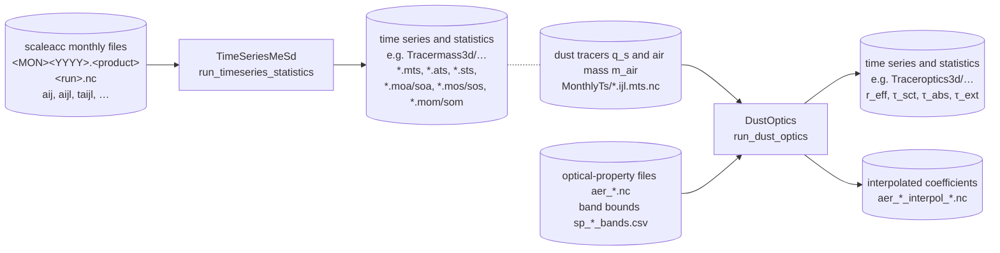
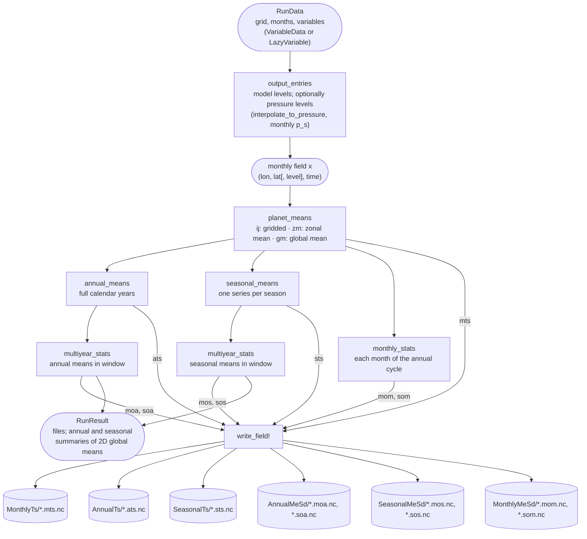
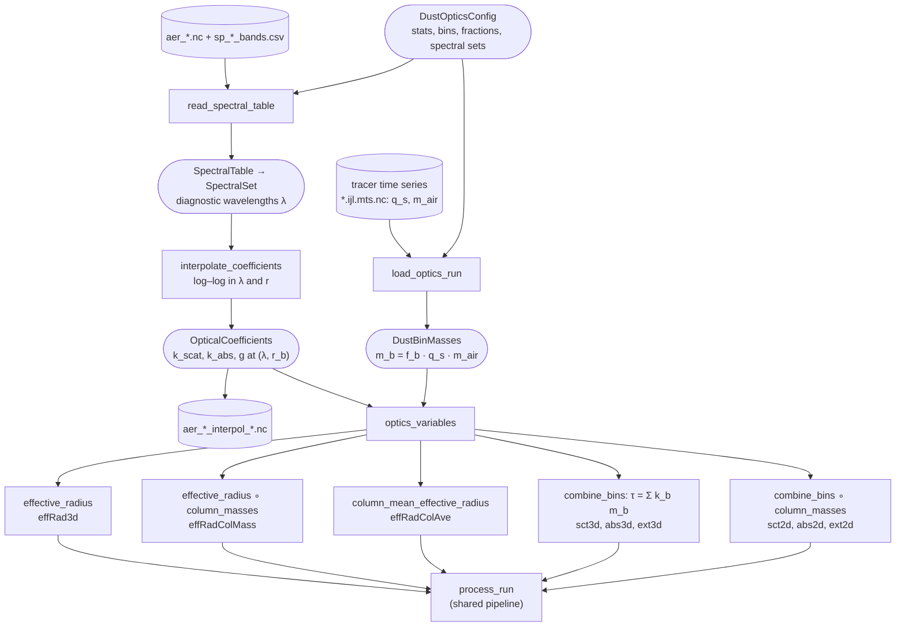
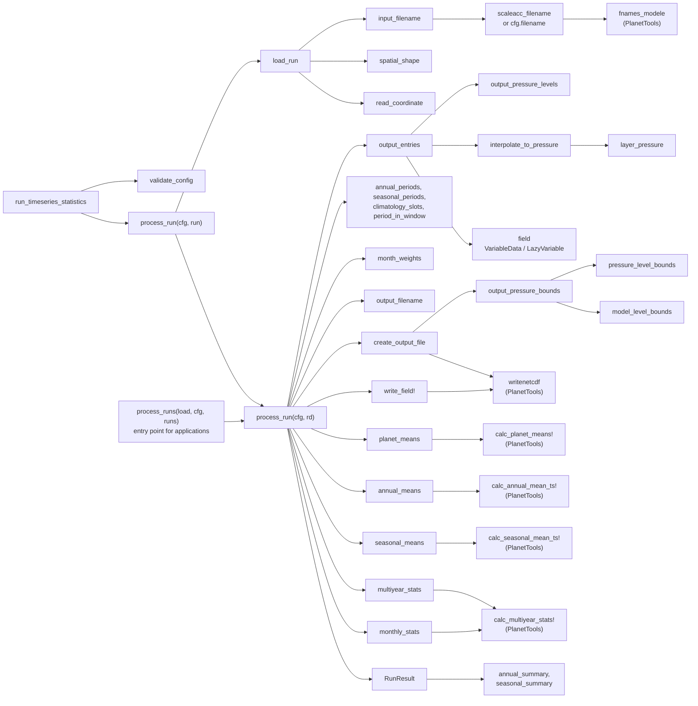
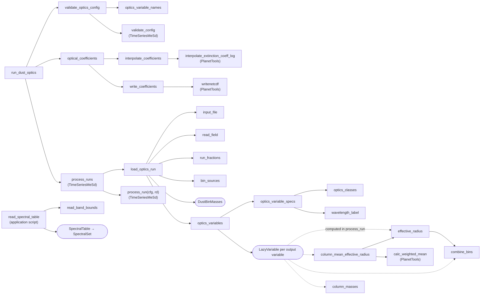

# Flowcharts

Data flow through the two submodules, and the function calls within each. Rectangles are
functions, rounded boxes are data, cylinders are files. Functions from `PlanetTools` are
marked *(PlanetTools)*.

## 1. Data flow between the submodules

## 2. Data flow within one run (shared pipeline)

`process_run(cfg, rd)` of `TimeSeriesMeSd`, used by both submodules. The variables are
processed one at a time; a `LazyVariable` is computed only here.

## 3. Data flow within DustOptics

## 4. Function calls: TimeSeriesMeSd

## 5. Function calls: DustOptics

